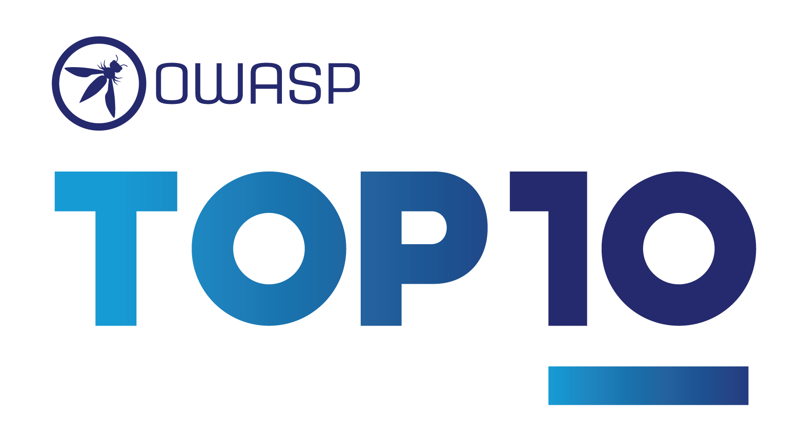
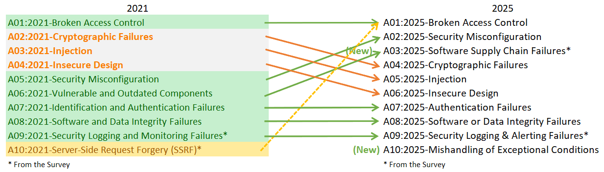

# En Kritik On Web Uygulaması Güvenlik Riski

# Giriş

OWASP Top Ten'in 8. sürümüne hoş geldiniz! 

Veri katkısında bulunan ve ankette görüşlerini paylaşan herkese içtenlikle teşekkür ederiz. Siz olmadan bu sürüm mümkün olmazdı. **TEŞEKKÜRLER!**

## OWASP Top 10:2025'e Genel Bakış

* [A01:2025 - Bozuk Erişim Kontrolü](A01_2025-Broken_Access_Control.md)
* [A02:2025 - Güvenlik Yapılandırma Hataları](A02_2025-Security_Misconfiguration.md)
* [A03:2025 - Yazılım Tedarik Zinciri Hataları](A03_2025-Software_Supply_Chain_Failures.md)
* [A04:2025 - Kriptografik Hatalar](A04_2025-Cryptographic_Failures.md)
* [A05:2025 - Enjeksiyon](A05_2025-Injection.md)
* [A06:2025 - Güvensiz Tasarım](A06_2025-Insecure_Design.md)
* [A07:2025 - Kimlik Doğrulama Hataları](A07_2025-Authentication_Failures.md)
* [A08:2025 - Yazılım veya Veri Bütünlüğü Hataları](A08_2025-Software_or_Data_Integrity_Failures.md)
* [A09:2025 - Güvenlik Günlüğü Kaydı ve Uyarı Hataları](A09_2025-Security_Logging_and_Alerting_Failures.md)
* [A10:2025 - İstisnai Durumların Hatalı Ele Alınması](A10_2025-Mishandling_of_Exceptional_Conditions.md)

## 2025 Top 10'da Neler Değişti

2025 Top Ten'de iki yeni kategori yer alıyor ve bir kategori başka bir kategoriyle birleştirildi. Odağımızı mümkün olduğunca belirtiler yerine kök nedende tutmaya çalıştık. Yazılım mühendisliğinin ve yazılım güvenliğinin karmaşıklığı göz önüne alındığında, birbiriyle hiç örtüşmeyen on kategori oluşturmak neredeyse imkânsızdır.

* **[A01:2025 - Bozuk Erişim Kontrolü](A01_2025-Broken_Access_Control.md)**, en ciddi uygulama güvenliği riski olarak 1. sıradaki yerini koruyor. Katkı sağlanan veriler, test edilen uygulamaların ortalama %3,73'ünde bu kategorideki 40 Common Weakness Enumeration (CWE) kaydından en az birinin bulunduğunu gösteriyor. Yukarıdaki şekilde kesikli çizgiyle gösterildiği gibi, Server-Side Request Forgery (SSRF) bu kategoriye dahil edildi.
* **[A02:2025 - Güvenlik Yapılandırma Hataları](A02_2025-Security_Misconfiguration.md)**, 2021'deki 5. sıradan 2025'te 2. sıraya yükseldi. Bu dönemin verilerinde yapılandırma hataları daha yaygın. Test edilen uygulamaların %3,00'ünde bu kategorideki 16 CWE'den en az biri bulundu. Yazılım mühendisliğinde uygulama davranışının giderek daha büyük bir kısmı yapılandırmaya dayandığı için bu durum şaşırtıcı değil.
* **[A03:2025 - Yazılım Tedarik Zinciri Hataları](A03_2025-Software_Supply_Chain_Failures.md)**, [A06:2021-Güvenlik Açığı Bulunan ve Güncel Olmayan Bileşenler](https://owasp.org/Top10/A06_2021-Vulnerable_and_Outdated_Components/) kategorisinin genişletilmiş hâlidir. Kapsamı, yazılım bağımlılıkları, derleme sistemleri ve dağıtım altyapısından oluşan ekosistemin içinde veya bu ekosistemin tamamında meydana gelen daha geniş bir yelpazedeki ele geçirme vakalarını içerecek şekilde genişletildi. Bu kategori, topluluk anketinde ezici bir çoğunlukla en önemli endişe olarak oylandı. Kategoride 5 CWE bulunuyor ve toplanan verilerde sınırlı ölçüde temsil ediliyor; ancak bunun test etmedeki zorluklardan kaynaklandığını düşünüyor ve test yöntemlerinin bu alanda da gelişmesini umuyoruz. Bu kategori verilerde en az görülen kategori olmakla birlikte, CVE'lerden elde edilen en yüksek ortalama istismar ve etki puanlarına da sahip.
* **[A04:2025 - Kriptografik Hatalar](A04_2025-Cryptographic_Failures.md)**, sıralamada iki basamak gerileyerek 2. sıradan 4. sıraya indi. Katkı sağlanan veriler, uygulamaların ortalama %3,80'inde bu kategorideki 32 CWE'den en az birinin bulunduğunu gösteriyor. Bu kategori çoğu zaman hassas verilerin ifşa olmasına veya sistemin ele geçirilmesine yol açar.
* **[A05:2025 - Enjeksiyon](A05_2025-Injection.md)**, sıralamada iki basamak gerileyerek 3. sıradan 5. sıraya indi; Kriptografik Hatalar ve Güvensiz Tasarım kategorilerine göre konumunu ise korudu. Enjeksiyon en çok test edilen kategorilerden biridir ve bu kategorideki 38 CWE, en fazla sayıda CVE ile ilişkilendirilmiştir. Enjeksiyon, Cross-site Scripting'den (yüksek sıklık/düşük etki) SQL Injection'a (düşük sıklık/yüksek etki) kadar uzanan bir dizi güvenlik açığını kapsar.
* **[A06:2025 - Güvensiz Tasarım](A06_2025-Insecure_Design.md)**, Güvenlik Yapılandırma Hataları ve Yazılım Tedarik Zinciri Hataları kategorilerinin önüne geçmesiyle sıralamada iki basamak gerileyerek 4. sıradan 6. sıraya indi. Bu kategori 2021'de eklendi; o zamandan bu yana sektörde tehdit modellemesi konusunda belirgin iyileşmeler gördük ve güvenli tasarıma daha fazla önem verildiğini gözlemledik.
* **[A07:2025 - Kimlik Doğrulama Hataları](A07_2025-Authentication_Failures.md)**, 7. sıradaki yerini koruyor. Bu kategorideki 36 CWE'yi daha doğru yansıtmak için adında küçük bir değişiklik yapıldı (önceki adı “[Kimlik Belirleme ve Kimlik Doğrulama Hataları](https://owasp.org/Top10/A07_2021-Identification_and_Authentication_Failures/)" idi). Kategori önemini korumakla birlikte, kimlik doğrulama için standartlaştırılmış framework'lerin daha yaygın kullanılması, kimlik doğrulama hatalarının görülme sıklığı üzerinde olumlu etki yaratıyor gibi görünüyor.
* **[A08:2025 - Yazılım veya Veri Bütünlüğü Hataları](A08_2025-Software_or_Data_Integrity_Failures.md)**, listede 8. sıradaki yerini sürdürüyor. Bu kategori, güven sınırlarının korunamamasına ve yazılım, kod ve veri artifact'lerinin bütünlüğünün Yazılım Tedarik Zinciri Hatalarına göre daha alt bir düzeyde doğrulanamamasına odaklanır. 
* **[A09:2025 - Güvenlik Günlüğü Kaydı ve Uyarı Hataları](A09_2025-Security_Logging_and_Alerting_Failures.md)**, 9. sıradaki yerini koruyor. İlgili günlük kaydı olaylarına uygun şekilde müdahale edilmesini sağlamak için gereken uyarı işlevinin önemini vurgulamak amacıyla kategorinin adında küçük bir değişiklik yapıldı (önceki adı [Güvenlik Günlüğü Kaydı ve İzleme Hataları](https://owasp.org/Top10/A09_2021-Security_Logging_and_Monitoring_Failures/)” idi). Uyarı üretmeyen kusursuz bir günlük kaydı, güvenlik olaylarının tespitinde çok az değer sağlar. Bu kategori verilerde her zaman yeterince temsil edilmeyecek; nitekim listeye yine topluluk anketi katılımcılarının oylarıyla girdi.
* **[A10:2025 - İstisnai Durumların Hatalı Ele Alınması](A10_2025-Mishandling_of_Exceptional_Conditions.md)**, 2025 için yeni bir kategoridir. Bu kategori; uygunsuz hata yönetimi, mantık hataları, açık kalacak şekilde başarısız olma (failing open) ve sistemlerin karşılaşabileceği olağan dışı durumlardan kaynaklanan diğer ilgili senaryolara odaklanan 24 CWE içerir.

## Metodoloji

Top Ten'in bu sürümü de verilerle desteklenmeye devam ediyor; ancak körü körüne verilere dayanmıyor. Katkı sağlanan verilere göre 12 kategoriyi sıraladık ve bunlardan ikisinin topluluk anketindeki yanıtlarla üst sıralara taşınmasına veya öne çıkarılmasına imkân tanıdık. Bunu temel bir nedenle yapıyoruz: Katkı sağlanan verileri incelemek, aslında geçmişe bakmak demektir. Uygulama güvenliği araştırmacıları yeni güvenlik açıklarını belirlemeye ve yeni test yöntemleri geliştirmeye zaman ayırır. Bu testlerin araçlara ve süreçlere entegre edilmesi haftalar, hatta yıllar sürer. Bir zayıflığı büyük ölçekte güvenilir biçimde test edebildiğimiz noktaya geldiğimizde yıllar geçmiş olabilir. Ayrıca hiçbir zaman güvenilir biçimde test edemeyebileceğimiz ve verilerde yer almayabilecek önemli riskler de vardır. Bu bakış açısını dengelemek için, sahada çalışan uygulama güvenliği ve yazılım geliştirme uzmanlarına bir topluluk anketi aracılığıyla, test verilerinde yeterince temsil edilmeyebilecek temel riskler olarak neleri gördüklerini soruyoruz.

## Kategorilerin Yapısı

OWASP Top Ten'in önceki sürümüne göre bazı kategoriler değişti. Kategori değişikliklerinin üst düzey bir özeti aşağıdadır.

Bu sürümde, 2021 sürümünde olduğu gibi CWE'ler konusunda herhangi bir kısıtlama getirmeden veri talep ettik. Belirli bir yılda (2021'den başlayarak) test edilen uygulama sayısını ve testlerde bir CWE'ye ait en az bir örneğin bulunduğu uygulama sayısını istedik. Bu format, her bir CWE'nin uygulama popülasyonu içinde ne kadar yaygın olduğunu izlememizi sağlar. Amacımız doğrultusunda sıklığı dikkate almıyoruz; sıklık başka durumlarda gerekli olabilse de burada yalnızca uygulama popülasyonundaki gerçek yaygınlığı gizler. Bir uygulamada bir CWE'nin dört ya da 4.000 örneğinin bulunması, Top Ten hesaplamasının bir parçası değildir. Özellikle manuel test uzmanları bir güvenlik açığını uygulamada kaç kez tekrarlandığına bakmaksızın genellikle yalnızca bir kez listelerken, otomatik test framework'leri bir güvenlik açığının her örneğini ayrı bir bulgu olarak listeler. Veri kümesinde analiz edilen CWE sayısı 2017'de yaklaşık 30 iken 2021'de 400'e yaklaştı, bu sürümde ise 589'a ulaştı. İleride bu çalışmaya ek olarak ilave veri analizleri yapmayı planlıyoruz. CWE sayısındaki bu önemli artış, kategorilerin yapılandırılma biçiminde değişiklik yapılmasını gerektiriyor.

CWE'leri gruplamak ve kategorilere ayırmak için birkaç ay harcadık; bu çalışmayı aylarca daha sürdürebilirdik, ancak bir noktada durmamız gerekiyordu. CWE'lerin bir kısmı kök nedeni, bir kısmı ise belirtiyi tanımlar: "Kriptografik Hata" ve "Yapılandırma Hatası" kök neden türüne, "Hassas Veri İfşası" ve "Hizmet Reddi" ise belirti türüne örnektir. Tespit ve düzeltme rehberliği sunmak açısından daha mantıklı olduğu için mümkün olan her durumda kök nedene odaklanmaya karar verdik. Belirti yerine kök nedene odaklanmak yeni bir yaklaşım değildir; Top Ten her zaman belirti ve kök nedenlerin bir karışımı olmuştur. CWE'ler de belirti ve kök nedenlerin bir karışımıdır; biz yalnızca bu ayrımı daha bilinçli biçimde vurguluyoruz. Bu sürümde kategori başına ortalama 25 CWE düşüyor; bu sayı, alt sınırdaki A03:2025-Yazılım Tedarik Zinciri Hataları ve A09:2025 Güvenlik Günlüğü Kaydı ve Uyarı Hataları kategorilerinde 5 CWE iken A01:2025-Bozuk Erişim Kontrolü kategorisinde 40 CWE'ye çıkıyor. Bir kategorideki CWE sayısını en fazla 40 ile sınırlamaya karar verdik. Güncellenen bu kategori yapısı, şirketlerin belirli bir dil/framework için anlamlı olan CWE'lere odaklanabilmesini sağladığı için eğitim açısından da ek faydalar sunar. 

Bize, MITRE Top 25 Most Dangerous Software Weaknesses listesine benzer şekilde neden Top 10 olarak 10 CWE'lik bir listeye geçmediğimiz soruldu. Kategorilerde birden fazla CWE kullanmamızın iki temel nedeni vardır. Birincisi, her CWE her programlama dilinde veya framework'te bulunmaz. Bu durum, Top Ten'in bir kısmı uygulanamaz hâle gelebileceğinden araçlar ve eğitim/farkındalık programları için sorun yaratır. İkinci neden, yaygın güvenlik açıkları için birden fazla CWE bulunmasıdır. Örneğin genel enjeksiyon, komut enjeksiyonu, Cross-site Scripting, koda gömülü (hardcoded) parolalar, doğrulama eksikliği, arabellek taşmaları, hassas bilgilerin açık metin olarak saklanması ve daha birçok konu için birden fazla CWE vardır. Kuruluşa veya test uzmanına bağlı olarak farklı CWE'ler kullanılabilir. Birden fazla CWE içeren kategoriler kullanarak, ortak bir kategori adı altında ortaya çıkabilecek farklı zayıflık türlerine ilişkin temel düzeyin ve farkındalığın yükseltilmesine katkıda bulunabiliriz. Top Ten 2025'in bu sürümünde 10 kategori altında 248 CWE bulunuyor. Bu sürümün yayımlandığı tarihte [MITRE'nin indirilebilir sözlüğünde](https://cwe.mitre.org) toplam 968 CWE yer alıyor.

## Kategorilerin Seçiminde Verilerin Kullanımı

2021 sürümünde olduğu gibi *İstismar Edilebilirlik* ve *(Teknik) Etki* için CVE verilerinden yararlandık. OWASP Dependency Check'i indirerek CVSS İstismar ve Etki puanlarını çıkardık ve bunları CVE'lerle birlikte listelenen ilgili CWE'lere göre grupladık. Bu epey araştırma ve emek gerektirdi; çünkü tüm CVE'lerin CVSSv2 puanı vardır, ancak CVSSv2'de CVSSv3'ün gidermesi beklenen kusurlar bulunur. Belirli bir tarihten sonra tüm CVE'lere ayrıca bir CVSSv3 puanı da atanmaktadır. Bunun yanında CVSSv2'den CVSSv3'e geçişte puan aralıkları ve formüller de güncellendi.

CVSSv2'de hem İstismar hem de (Teknik) Etki puanı 10,0'a kadar çıkabiliyordu; ancak formül bu değerleri İstismar için %60'a, Etki için %40'a indiriyordu. CVSSv3'te ise teorik üst sınır İstismar için 6,0, Etki için 4,0 olarak belirlendi. Ağırlıklandırma dikkate alındığında, CVSSv3'te Etki puanları ortalama yaklaşık bir buçuk puan yükselirken istismar edilebilirlik puanları ortalama yaklaşık yarım puan düştü.

OWASP Dependency Check'ten çıkarılan verilere göre National Vulnerability Database'de (NVD) CWE'lerle eşlenmiş yaklaşık 175 bin CVE kaydı bulunuyor (2021'de bu sayı 125 bindi). Ayrıca CVE'lerle eşlenmiş 643 benzersiz CWE var (2021'de 241). Çıkarılan yaklaşık 220 bin CVE'nin 160 bininde CVSS v2, 156 bininde CVSS v3 ve 6 bininde CVSS v4 puanı bulunuyor. Birçok CVE'nin birden fazla puanı olduğundan bu sayıların toplamı 220 bini aşıyor.

Top Ten 2025 için ortalama istismar ve etki puanlarını şu şekilde hesapladık: CVSS puanına sahip tüm CVE'leri CWE'ye göre grupladık; genel bir ortalama elde etmek için hem istismar hem de etki puanlarını, popülasyonun CVSSv3 puanına sahip kısmının ve CVSSv2 puanına sahip geri kalan kısmının yüzdesine göre ağırlıklandırdık. Bu ortalamaları, risk denkleminin diğer yarısında İstismar ve (Teknik) Etki puanı olarak kullanmak üzere veri kümesindeki CWE'lerle eşledik.

Neden CVSS v4.0'ı kullanmadığımızı sorabilirsiniz. Bunun nedeni, puanlama algoritmasının köklü biçimde değişmesi ve artık CVSS v2 ile CVSSv3'te olduğu gibi *İstismar* veya *Etki* puanlarını kolayca sunmamasıdır. Top Ten'in gelecek sürümlerinde CVSS v4.0 puanlamasını kullanmanın bir yolunu bulmaya çalışacağız; ancak 2025 sürümü için bunu zamanında yapmanın bir yolunu belirleyemedik.

## Neden Topluluk Anketi Kullanıyoruz

Verilerdeki sonuçlar büyük ölçüde sektörün otomatik olarak test edebildikleriyle sınırlıdır. Deneyimli bir uygulama güvenliği (AppSec) uzmanıyla konuştuğunuzda size henüz verilere yansımamış bulgularından ve gözlemlediği eğilimlerden söz edecektir. Belirli güvenlik açığı türleri için test metodolojileri geliştirmek zaman alır; bu testlerin otomatikleştirilip çok sayıda uygulamaya karşı çalıştırılması ise daha da fazla zaman gerektirir. Bulduğumuz her şey geçmişe dönüktür ve verilerde henüz yer almayan son bir yılın eğilimlerini kaçırıyor olabilir.

Bu nedenle, veriler eksik olduğu için on kategoriden yalnızca sekizini verilere göre seçiyoruz. Diğer iki kategori Top 10 topluluk anketinden gelir. Anket, sahadaki uzmanların verilerde yer almayabilecek (ve belki hiçbir zaman verilere yansımayacak) en yüksek riskler olarak gördükleri konuları oylamasına olanak tanır.

## Veri Katkısında Bulunanlara Teşekkürler

Aşağıdaki kuruluşlar (birkaç anonim bağışçıyla birlikte), 2,8 milyonu aşkın uygulamaya ait verileri nazikçe bağışlayarak bu veri kümesini en büyük ve en kapsamlı uygulama güvenliği veri kümesi hâline getirdi. Siz olmadan bu mümkün olmazdı.

* Accenture (Prag)
* Anonim (birden fazla)
* Bugcrowd
* Contrast Security
* CryptoNet Labs
* Intuitor SoftTech Services
* Orca Security
* Probely
* Semgrep
* Sonar
* usd AG
* Veracode
* Wallarm

## Baş Yazarlar
* Andrew van der Stock - X: [@vanderaj](https://x.com/vanderaj)
* Brian Glas - X: [@infosecdad](https://x.com/infosecdad)
* Neil Smithline - X: [@appsecneil](https://x.com/appsecneil)
* Tanya Janca - X: [@shehackspurple](https://x.com/shehackspurple)
* Torsten Gigler - Mastodon: [@torsten_gigler@infosec.exchange](https://infosec.exchange/@torsten_gigler)

## Sorun ve Pull Request Bildirimi

Düzeltme önerilerinizi veya karşılaştığınız sorunları lütfen bildirin:

### Proje bağlantıları:
* [Ana sayfa](https://owasp.org/www-project-top-ten/)
* [GitHub deposu](https://github.com/OWASP/Top10)

