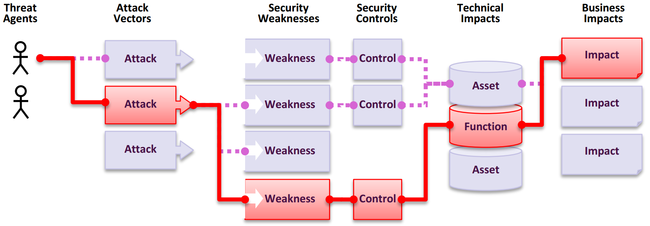

# Uygulama Güvenliği Riskleri Nelerdir?
Saldırganlar, işletmenize veya kuruluşunuza zarar vermek için uygulamanız üzerinden birçok farklı yol kullanabilir. Bu yolların her biri, incelenmesi gereken potansiyel bir risk oluşturur.

<table>
  <tr>
   <td>
    <strong>Tehdit Aktörleri</strong>
   </td>
   <td>
    <strong>Saldırı \
Vektörleri</strong>
   </td>
   <td>
    <strong>İstismar Edilebilirlik</strong>
   </td>
   <td>
    <strong>Güvenlik Kontrollerinin Eksik</strong>

    <strong>Olma Olasılığı</strong>
   </td>
   <td>
    <strong>Teknik</strong>

    <strong>Etkiler</strong>
   </td>
   <td>
    <strong>İşletmeye</strong>

    <strong>Etkiler</strong>
   </td>
  </tr>
  <tr>
   <td>
    <strong>Ortama göre, \
durum tablosuna göre dinamik</strong>
   </td>
   <td>
    <strong>Uygulamanın maruziyetine göre (ortama göre)</strong>
   </td>
   <td>
    <strong>Ort. Ağırlıklı İstismar</strong>
   </td>
   <td>
    <strong>Eksik Kontroller \
ortalama görülme oranına göre, \
kapsama göre ağırlıklandırılmış</strong>
   </td>
   <td>
    <strong>Ort. Ağırlıklı Etki</strong>
   </td>
   <td>
    <strong>İşletmeye göre</strong>
   </td>
  </tr>
</table>

Risk derecelendirmemizde istismar edilebilirlik, bir zayıflık için güvenlik kontrollerinin eksik olmasının ortalama olasılığı ve zayıflığın teknik etkileri gibi evrensel parametreleri dikkate aldık. 

Her kuruluş benzersizdir; o kuruluşu hedef alan tehdit aktörleri, bu aktörlerin amaçları ve olası bir ihlalin etkisi de öyle. Kamu yararına çalışan bir kuruluş kamuya açık bilgiler için bir içerik yönetim sistemi (CMS) kullanırken bir sağlık kuruluşu aynı CMS'i hassas sağlık kayıtları için kullanıyorsa, aynı yazılım için tehdit aktörleri ve iş etkileri birbirinden çok farklı olabilir. Kuruluşunuzun karşı karşıya olduğu riski; uygulamanın maruziyetine, durum tablosuna göre ilgili tehdit aktörlerine (iş koluna ve konuma göre hedefli ve hedefsiz saldırılar için) ve kuruluşunuza özgü iş etkilerine göre anlamak kritik önem taşır. 

## Kategorilerin Seçilmesinde ve Sıralanmasında Verilerin Kullanımı

2017'de olasılığı belirlemek için kategorileri görülme oranına göre seçtik; ardından onlarca yıllık deneyime dayanan ekip tartışmalarıyla bunları İstismar Edilebilirlik, Tespit Edilebilirlik (bu da olasılıkla ilgilidir) ve Teknik Etki açısından sıraladık. 2021'de İstismar Edilebilirlik ve (Teknik) Etki için National Vulnerability Database'deki (NVD) CVSSv2 ve CVSSv3 puanlarından elde edilen verileri kullandık. 2025'te de 2021'de oluşturduğumuz metodolojiyi sürdürdük.

OWASP Dependency Check'i indirerek ilgili CWE'lere göre gruplanmış CVSS İstismar ve Etki puanlarını çıkardık. Bu epey araştırma ve emek gerektirdi; çünkü tüm CVE'lerin CVSSv2 puanı vardır, ancak CVSSv2'de CVSSv3'ün gidermesi beklenen kusurlar bulunur. Belirli bir tarihten sonra tüm CVE'lere ayrıca bir CVSSv3 puanı da atanmaktadır. Bunun yanında CVSSv2'den CVSSv3'e geçişte puan aralıkları ve formüller de güncellendi. 

CVSSv2'de hem İstismar hem de (Teknik) Etki puanı 10,0'a kadar çıkabiliyordu; ancak formül bu değerleri İstismar için %60'a, Etki için %40'a indiriyordu. CVSSv3'te ise teorik üst sınır İstismar için 6,0, Etki için 4,0 olarak belirlendi. 2021 Top Ten için yaptığımız analizde, ağırlıklandırma dikkate alındığında CVSSv3'te Etki puanlarının ortalama yaklaşık bir buçuk puan yükseldiğini, istismar edilebilirlik puanlarının ise ortalama yaklaşık yarım puan düştüğünü gördük.

OWASP Dependency Check'ten çıkarılan verilere göre National Vulnerability Database'de (NVD) CWE'lerle eşlenmiş yaklaşık 175 bin CVE kaydı bulunuyor (2021'de bu sayı 125 bindi). Ayrıca CVE'lerle eşlenmiş 643 benzersiz CWE var (2021'de 241). Çıkarılan yaklaşık 220 bin CVE'nin 160 bininde CVSS v2, 156 bininde CVSS v3 ve 6 bininde CVSS v4 puanı bulunuyor. Birçok CVE'nin birden fazla puanı olduğundan bu sayıların toplamı 220 bini aşıyor.

Top Ten 2025 için ortalama istismar ve etki puanlarını şu şekilde hesapladık: CVSS puanına sahip tüm CVE'leri CWE'ye göre grupladık; genel bir ortalama elde etmek için hem istismar hem de etki puanlarını, popülasyonun CVSSv3 puanına sahip kısmının ve CVSSv2 puanına sahip geri kalan kısmının yüzdesine göre ağırlıklandırdık. Bu ortalamaları, risk denkleminin diğer yarısında İstismar ve (Teknik) Etki puanı olarak kullanmak üzere veri kümesindeki CWE'lerle eşledik.

Neden CVSS v4.0'ı kullanmadığımızı sorabilirsiniz. Bunun nedeni, puanlama algoritmasının köklü biçimde değişmesi ve artık CVSSv2 ile CVSSv3'te olduğu gibi *İstismar* veya *Etki* puanlarını kolayca sunmamasıdır. Top Ten'in gelecek sürümlerinde CVSS v4.0 puanlamasını kullanmanın bir yolunu bulmaya çalışacağız; ancak 2025 sürümü için bunu zamanında yapmanın bir yolunu belirleyemedik.

Görülme oranı için, bir kuruluşun belirli bir dönemde test ettiği uygulama popülasyonu içinde her bir CWE'ye karşı savunmasız olan uygulamaların yüzdesini hesapladık. Hatırlatmak gerekirse, sıklığı (yani bir sorunun bir uygulamada kaç kez görüldüğünü) kullanmıyoruz; bizi ilgilendiren, uygulama popülasyonunun yüzde kaçında her bir CWE'nin tespit edildiğidir. 

Kapsam için, tüm kuruluşların belirli bir CWE açısından test ettiği uygulamaların yüzdesine bakıyoruz. Hesaplanan kapsam ne kadar yüksekse örneklem popülasyonu o kadar iyi temsil eder ve görülme oranının doğru olduğuna dair güvence o kadar güçlenir.

Bu sürümde kullandığımız formül, bazı ağırlıklandırma değişiklikleri dışında 2021'dekine benzer:
(Maks. Görülme Oranı % * 1000) + (Maks. Kapsam % * 100) + (Ort. İstismar * 10) + (Ort. Etki * 20) + (Toplam Görülme / 10000) = Risk Puanı

Hesaplanan puanlar, Bozuk Erişim Kontrolü kategorisi için 621,60 ile Bellek Yönetimi Hataları kategorisi için 271,08 arasında değişti.

Bu kusursuz bir sistem değildir; ancak risk kategorilerini sıralamak için değerlidir.

Giderek büyüyen bir diğer zorluk da "uygulama" kavramının tanımıdır. Sektör, mikro hizmetlerden ve geleneksel bir uygulamadan daha küçük olan başka yapılardan oluşan farklı mimarilere yöneldikçe hesaplamalar zorlaşıyor. Örneğin bir kuruluş kod depolarını test ediyorsa neyi uygulama olarak kabul eder? CVSSv4'ün yaygınlaşmasına benzer şekilde, Top Ten'in bir sonraki sürümünde sürekli değişen sektörü hesaba katmak için analiz ve puanlamanın yeniden düzenlenmesi gerekebilir.

## Veri Faktörleri

Top Ten kategorilerinin her biri için listelenen veri faktörleri ve anlamları aşağıda verilmiştir:

**Eşlenen CWE'ler:** Top Ten ekibi tarafından bir kategoriyle eşlenen CWE sayısı.

**Görülme Oranı:** İlgili kuruluşun o yıl test ettiği popülasyon içinde söz konusu CWE'ye karşı savunmasız olan uygulamaların yüzdesi.

**Ağırlıklı İstismar:** CWE'lerle eşlenen CVE'lere atanmış CVSSv2 ve CVSSv3 puanlarındaki İstismar alt puanının normalleştirilip 10 puanlık bir ölçeğe yerleştirilmiş hâli.

**Ağırlıklı Etki:** CWE'lerle eşlenen CVE'lere atanmış CVSSv2 ve CVSSv3 puanlarındaki Etki alt puanının normalleştirilip 10 puanlık bir ölçeğe yerleştirilmiş hâli.

**(Test) Kapsamı:** Belirli bir CWE için tüm kuruluşlar tarafından test edilen uygulamaların yüzdesi.

**Toplam Görülme:** Bir kategoriyle eşlenen CWE'lerin bulunduğu tespit edilen toplam uygulama sayısı.

**Toplam CVE:** NVD veritabanında, bir kategoriyle eşlenen CWE'lerle eşlenmiş toplam CVE sayısı.

**Formül:** (Maks. Görülme Oranı % * 1000) + (Maks. Kapsam % * 100) + (Ort. İstismar * 10) + (Ort. Etki * 20) + (Toplam Görülme / 10000) = Risk Puanı
