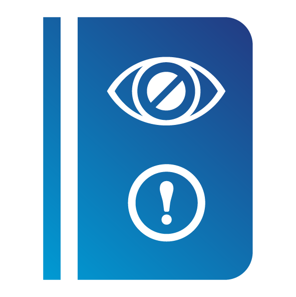

# A09:2025 Güvenlik Günlüğü Kaydı ve Uyarı Hataları {: style="height:80px;width:80px" align="right"}

## Arka Plan. 

Güvenlik Günlüğü Kaydı ve Uyarı Hataları, 9. sıradaki yerini koruyor. İlgili günlük kaydı olaylarında harekete geçilmesini sağlamak için gereken uyarı işlevini vurgulamak amacıyla kategorinin adında küçük bir değişiklik yapıldı. Bu kategori verilerde her zaman yeterince temsil edilmeyecek; nitekim listeye üçüncü kez topluluk anketi katılımcılarının oylarıyla girdi. Bu kategoriyi test etmek son derece zordur ve CVE/CVSS verilerinde çok az temsil edilir (yalnızca 723 CVE); ancak görünürlük, olay uyarıları ve adli analiz açısından çok büyük etkisi olabilir. Bu kategori, *günlük dosyalarına yazılan çıktının doğru şekilde kodlanması (CWE-117), günlük dosyalarına hassas veri eklenmesi (CWE-532) ve yetersiz günlük kaydı (CWE-778)* ile ilgili sorunları içerir.

## Puan Tablosu.

<table>
  <tr>
   <td>Eşlenen CWE'ler 
   </td>
   <td>Maks. Görülme Oranı
   </td>
   <td>Ort. Görülme Oranı
   </td>
   <td>Maks. Kapsam
   </td>
   <td>Ort. Kapsam
   </td>
   <td>Ort. Ağırlıklı İstismar
   </td>
   <td>Ort. Ağırlıklı Etki
   </td>
   <td>Toplam Görülme
   </td>
   <td>Toplam CVE
   </td>
  </tr>
  <tr>
   <td>5
   </td>
   <td>11.33%
   </td>
   <td>3.91%
   </td>
   <td>85.96%
   </td>
   <td>46.48%
   </td>
   <td>7.19
   </td>
   <td>2.65
   </td>
   <td>260,288
   </td>
   <td>723
   </td>
  </tr>
</table>

## Açıklama. 

Günlük kaydı ve izleme olmadan saldırılar ve ihlaller tespit edilemez; uyarı mekanizması olmadan da bir güvenlik olayı sırasında hızlı ve etkili şekilde müdahale etmek çok zordur. Aktif müdahaleyi başlatacak günlük kaydı, sürekli izleme, tespit ve uyarı mekanizmalarındaki yetersizlik şu durumlarda ortaya çıkar:

* Oturum açma, başarısız oturum açma girişimleri ve yüksek değerli işlemler gibi denetlenebilir olaylar günlüğe kaydedilmiyor veya tutarsız biçimde kaydediliyorsa (örneğin yalnızca başarılı oturum açma işlemleri kaydedilip başarısız girişimler kaydedilmiyorsa).
* Uyarılar ve hatalar hiç günlük mesajı üretmiyor ya da yetersiz veya belirsiz günlük mesajları üretiyorsa.
* Günlük kayıtlarının bütünlüğü kurcalamaya karşı gerektiği gibi korunmuyorsa.
* Uygulamaların ve API'lerin günlük kayıtları şüpheli etkinliklere karşı izlenmiyorsa.
* Günlük kayıtları yalnızca yerel olarak saklanıyor ve gerektiği gibi yedeklenmiyorsa.
* Uygun uyarı eşikleri ve müdahale eskalasyon süreçleri mevcut değilse veya etkili değilse. Uyarılar makul bir süre içinde alınmıyor ya da incelenmiyorsa.
* Sızma testleri ve dinamik uygulama güvenliği testi (DAST) araçlarıyla (Burp veya ZAP gibi) yapılan taramalar uyarıları tetiklemiyorsa.
* Uygulama, aktif saldırıları gerçek zamanlı veya gerçek zamanlıya yakın biçimde tespit edemiyor, eskale edemiyor ya da bunlar için uyarı üretemiyorsa.
* Günlük kaydı ve uyarı olaylarını bir kullanıcıya veya saldırgana görünür hâle getirerek (bkz. [A01:2025-Bozuk Erişim Kontrolü](A01_2025-Broken_Access_Control.md)) ya da günlüğe kaydedilmemesi gereken hassas bilgileri (PII veya PHI gibi) kaydederek hassas bilgi sızıntısına açık hâle geliyorsanız.
* Günlük verileri doğru şekilde kodlanmadığı için günlük kaydı veya izleme sistemlerine yönelik enjeksiyonlara ya da saldırılara açıksanız.
* Uygulama hataları ve diğer istisnai durumları gözden kaçırıyor veya hatalı ele alıyorsa ve bu nedenle sistem bir hata oluştuğundan habersiz kalıp bir sorun yaşandığını günlüğe kaydedemiyorsa.
* Özel bir durumu tanımak için uyarı üretmeye yönelik yeterli ‘kullanım senaryoları’ (use case) eksik veya güncelliğini yitirmişse.
* Çok sayıda yanlış pozitif uyarı, önemli uyarıları önemsiz olanlardan ayırt etmeyi imkânsız hâle getiriyor ve bu uyarıların çok geç fark edilmesine ya da hiç fark edilmemesine yol açıyorsa (SOC ekibinin fiziksel olarak aşırı yüklenmesi).
* İlgili kullanım senaryosuna ait müdahale rehberi (playbook) eksik, güncel değil veya hiç bulunmadığı için tespit edilen uyarılar doğru şekilde işlenemiyorsa.

## Nasıl Önlenir.

Geliştiriciler, uygulamanın riskine bağlı olarak aşağıdaki kontrollerin bir kısmını veya tamamını uygulamalıdır:

* Tüm oturum açma, erişim kontrolü ve sunucu tarafı girdi doğrulama hatalarının, şüpheli veya kötü amaçlı hesapları belirlemeye yetecek kullanıcı bağlamıyla günlüğe kaydedilebildiğinden ve sonradan yapılacak adli analize olanak tanıyacak kadar uzun süre saklandığından emin olun.
* Uygulamanızda güvenlik kontrolü içeren her bölümün, başarılı ya da başarısız olmasından bağımsız olarak günlüğe kaydedildiğinden emin olun.
* Günlük kayıtlarının, günlük yönetimi çözümlerinin kolayca işleyebileceği bir formatta üretildiğinden emin olun.
* Günlük kaydı veya izleme sistemlerine yönelik enjeksiyonları ya da saldırıları önlemek için günlük verilerinin doğru şekilde kodlandığından emin olun.
* Tüm işlemlerin, kurcalanmayı veya silinmeyi önleyen bütünlük kontrollerine sahip bir denetim izi (ör. yalnızca ekleme yapılabilen (append-only) veritabanı tabloları veya benzerleri) bulunduğundan emin olun.
* Hata veren tüm işlemlerin geri alındığından ve yeniden başlatıldığından emin olun. Her zaman güvenli şekilde başarısız olun (fail closed).
* Uygulamanız veya kullanıcıları şüpheli davranırsa uyarı üretin. Geliştiricilerinizin buna yönelik kod yazabilmesi ya da bu amaçla bir sistem satın alabilmesi için bu konuda rehberlik hazırlayın.
* DevSecOps ve güvenlik ekipleri, şüpheli etkinliklerin Güvenlik Operasyon Merkezi (SOC) ekibi tarafından hızla tespit edilmesini ve bunlara hızla müdahale edilmesini sağlayacak şekilde, playbook'lar da içeren etkili izleme ve uyarı kullanım senaryoları oluşturmalıdır.
* Uygulamanıza saldırganlar için tuzak işlevi gören ‘honeytoken’lar ekleyin; ör. veritabanına, verilere, gerçek ve/veya teknik kullanıcı kimliği olarak. Bunlar olağan iş süreçlerinde kullanılmadığından, bunlara yapılan her erişim, neredeyse hiç yanlış pozitif olmadan uyarıya dönüştürülebilecek günlük verileri üretir.
* Davranış analizi ve yapay zekâ desteği, uyarılarda yanlış pozitif oranlarını düşük tutmaya destek olmak için isteğe bağlı ek bir teknik olarak kullanılabilir.
* National Institute of Standards and Technology (NIST) 800-61r2 veya sonraki sürümleri gibi bir olay müdahale ve kurtarma planı oluşturun ya da benimseyin. Yazılım geliştiricilerinize uygulama saldırılarının ve olaylarının neye benzediğini öğretin ki bunları bildirebilsinler.

Bu sorunlarla mücadele etmenize yardımcı olabilecek, özel panolar ve uyarı özellikleri sunan, OWASP ModSecurity Core Rule Set gibi ticari ve açık kaynaklı uygulama koruma ürünleri ile Elasticsearch, Logstash, Kibana (ELK) yığını gibi açık kaynaklı günlük korelasyon yazılımları bulunmaktadır. Saldırılara gerçek zamanlıya yakın biçimde müdahale etmenize veya bunları engellemenize yardımcı olabilecek ticari gözlemlenebilirlik araçları da mevcuttur.

## Örnek Saldırı Senaryoları.

**Senaryo #1:** Çocuklara yönelik bir sağlık planı sağlayıcısının web sitesi işletmecisi, izleme ve günlük kaydı eksikliği nedeniyle bir ihlali tespit edemedi. Harici bir taraf, sağlık planı sağlayıcısına bir saldırganın 3,5 milyondan fazla çocuğa ait binlerce hassas sağlık kaydına erişip bunları değiştirdiğini bildirdi. Olay sonrası inceleme, web sitesi geliştiricilerinin önemli güvenlik açıklarını gidermediğini ortaya koydu. Sistemde günlük kaydı veya izleme bulunmadığından veri ihlali 2013'ten beri, yani yedi yılı aşkın bir süredir devam ediyor olabilirdi.

**Senaryo #2:** Hindistan'ın büyük havayollarından biri, pasaport ve kredi kartı verileri dahil milyonlarca yolcunun on yılı aşkın süreye ait kişisel verilerini içeren bir veri ihlali yaşadı. Veri ihlali üçüncü taraf bir bulut barındırma sağlayıcısında meydana geldi ve sağlayıcı havayolunu ihlalden ancak bir süre sonra haberdar etti.

**Senaryo #3:** Avrupa'nın büyük havayollarından biri, GDPR kapsamında bildirilmesi zorunlu bir ihlal yaşadı. Bildirildiğine göre ihlal, saldırganların istismar ettiği ödeme uygulaması güvenlik açıklarından kaynaklandı; saldırganlar 400.000'den fazla müşteri ödeme kaydını ele geçirdi. Bunun sonucunda havayolu, veri koruma otoritesi tarafından 20 milyon sterlin para cezasına çarptırıldı.

## Kaynaklar.

-   [OWASP Proactive Controls: C9: Implement Logging and Monitoring](https://top10proactive.owasp.org/archive/2024/the-top-10/c9-security-logging-and-monitoring/)

-   [OWASP Application Security Verification Standard: V16 Security Logging and Error Handling](https://github.com/OWASP/ASVS/blob/v5.0.0/5.0/en/0x25-V16-Security-Logging-and-Error-Handling.md)

-   [OWASP Cheat Sheet: Application Logging Vocabulary](https://cheatsheetseries.owasp.org/cheatsheets/Application_Logging_Vocabulary_Cheat_Sheet.html)

-   [OWASP Cheat Sheet: Logging](https://cheatsheetseries.owasp.org/cheatsheets/Logging_Cheat_Sheet.html)

-   [Data Integrity: Recovering from Ransomware and Other Destructive Events](https://csrc.nist.gov/publications/detail/sp/1800-11/final)

-   [Data Integrity: Identifying and Protecting Assets Against Ransomware and Other Destructive Events](https://csrc.nist.gov/publications/detail/sp/1800-25/final)

-   [Data Integrity: Detecting and Responding to Ransomware and Other Destructive Events](https://csrc.nist.gov/publications/detail/sp/1800-26/final)

-   [Snowflake ihlalinde bu tür hataların gerçek dünyadan bir örneği](https://www.huntress.com/threat-library/data-breach/snowflake-data-breach)

## Eşlenen CWE'lerin Listesi

* [CWE-117 Improper Output Neutralization for Logs](https://cwe.mitre.org/data/definitions/117.html)

* [CWE-221 Information Loss of Omission](https://cwe.mitre.org/data/definitions/221.html)

* [CWE-223 Omission of Security-relevant Information](https://cwe.mitre.org/data/definitions/223.html)

* [CWE-532 Insertion of Sensitive Information into Log File](https://cwe.mitre.org/data/definitions/532.html)

* [CWE-778 Insufficient Logging](https://cwe.mitre.org/data/definitions/778.html)
